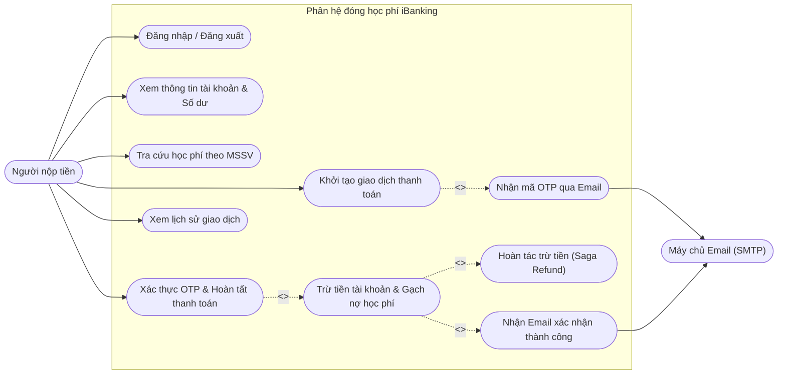
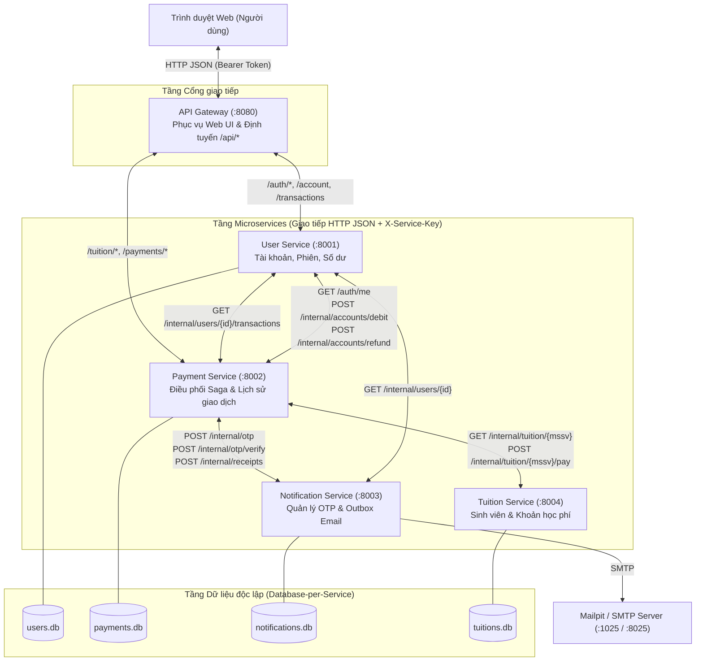

# Phân tích Nghiệp vụ, Thiết kế Dữ liệu & Kiến trúc Microservices

Tài liệu tổng hợp toàn bộ phần phân tích và thiết kế của dự án giữa kỳ môn **SOA (CS504070)** — Phân hệ đóng học phí ứng dụng iBanking.

---

## 1. Phân tích Nghiệp vụ & Use Case Diagram

### 1.1. Các tác nhân (Actors)
- **Người nộp tiền (User/Payer)**: Đăng nhập vào iBanking, xem số dư & hồ sơ cá nhân, tra cứu học phí theo MSSV (cho chính mình hoặc sinh viên khác), khởi tạo giao dịch thanh toán, nhập mã OTP xác nhận và xem lịch sử giao dịch.
- **Hệ thống Email / SMTP (Mailpit / SMTP Server)**: Tiếp nhận và chuyển phát email chứa mã OTP (hiệu lực tối đa 5 phút) và email biên lai xác nhận thanh toán thành công.

### 1.2. Phân tích nghiệp vụ Tra cứu học phí & Thanh toán (Thành viên 2)
1. **Thông tin người nộp tiền**:
   - Họ và tên, Số điện thoại, Địa chỉ email được lấy tự động từ phiên đăng nhập (`GET /api/auth/me`) và hiển thị ở chế độ chỉ đọc (`readonly`), người dùng không được chỉnh sửa.
2. **Tra cứu thông tin học phí theo MSSV**:
   - Khi người dùng nhập MSSV, giao diện tự động gọi `GET /api/tuition/{student_id}` để hiển thị: Mã số sinh viên, Họ và tên sinh viên, Khoa/Ngành, Học kỳ, Trạng thái học phí (`UNPAID` / `PAID`) và Số tiền học phí cần thanh toán.
   - **Quy tắc thanh toán toàn bộ**: Hệ thống chỉ cho phép thanh toán **100% toàn bộ khoản học phí**, từ chối mọi yêu cầu thanh toán một phần (`400 PARTIAL_PAYMENT_NOT_ALLOWED`).
3. **Kiểm tra điều kiện & Khởi tạo giao dịch**:
   - Nút **Xác nhận giao dịch** chỉ được kích hoạt khi thỏa mãn đồng thời 4 điều kiện:
     1. MSSV tồn tại trong hệ thống;
     2. Khoản học phí ở trạng thái `UNPAID` (chưa thanh toán);
     3. Số dư khả dụng của người nộp `>=` Số tiền học phí cần đóng;
     4. Người dùng đã tích chọn đồng ý thỏa thuận và điều khoản của hệ thống.
   - Khi khởi tạo (`POST /api/payments`), `Payment Service` tạo bản ghi giao dịch trạng thái `PENDING` và gọi `Notification Service` sinh mã OTP 6 chữ số (không trùng với bất kỳ OTP nào đang `ACTIVE`, thời hạn 5 phút) gửi qua email người nộp.

### 1.3. Sơ đồ Use Case Tổng thể



*(File PlantUML tương ứng: [docs/use-case.puml](file:///d:/nhat-linh/docs/use-case.puml))*

---

## 2. Thiết kế Cơ sở dữ liệu & Sơ đồ ERD Tổng thể

Hệ thống áp dụng mẫu thiết kế **Database-per-Service** sử dụng SQLite ở chế độ `WAL (Write-Ahead Logging)` kết hợp khóa giao dịch `BEGIN IMMEDIATE` để đảm bảo tính nguyên tử (Atomicity) và cô lập (Isolation) cho từng service.

```mermaid
erDiagram
    USERS ||--o{ SESSIONS : "has"
    USERS ||--o{ ACCOUNT_OPERATIONS : "executes"
    STUDENTS ||--|| TUITIONS : "owes"
    USERS ||..o{ PAYMENTS : "initiates (user_id)"
    STUDENTS ||..o{ PAYMENTS : "for (student_id)"
    PAYMENTS ||..|| OTP_CHALLENGES : "verified_by (transaction_id)"
    PAYMENTS ||..o{ EMAIL_OUTBOX : "triggers"

    USERS {
        int id PK
        string username UK
        string password_hash
        string salt
        string full_name
        string phone
        string email
        int balance "CHECK (balance >= 0)"
    }
    SESSIONS {
        string token_hash PK
        int user_id FK
        int expires_at
    }
    LOGIN_ATTEMPTS {
        string client_key PK
        int failures
        int expires_at
    }
    ACCOUNT_OPERATIONS {
        string transaction_id PK
        int user_id FK
        int amount "CHECK (amount > 0)"
        string status "DEBITED | REFUNDED"
        int created_at
        int refunded_at
    }
    STUDENTS {
        string student_id PK
        string full_name
        string faculty
        string major
        string academic_year
    }
    TUITIONS {
        string student_id PK_FK
        string semester
        int amount "CHECK (amount > 0)"
        string status "UNPAID | RESERVED | PAID"
        string reserved_by
        int reserved_until
        string paid_transaction_id UK
        int paid_by_user_id
        int paid_at
    }
    PAYMENTS {
        string id PK
        string idempotency_key UK
        int user_id
        string payer_name
        string payer_phone
        string payer_email
        string student_id
        string student_name
        string semester
        int amount
        string status "PENDING | PROCESSING | SUCCESS | FAILED | EXPIRED"
        string failure_code
        string failure_message
        string verification_id
        int debit_completed
        int tuition_completed
        int receipt_queued
        int needs_refund
        int created_at
        int expires_at
        int completed_at
    }
    OTP_CHALLENGES {
        string transaction_id PK
        int user_id
        string student_id
        int amount
        string code_hash "UNIQUE WHERE ACTIVE"
        string status "ACTIVE | CONSUMED | EXPIRED | LOCKED"
        int attempts
        int created_at
        int expires_at
        int consumed_at
        string verification_id UK
    }
    EMAIL_OUTBOX {
        string event_id PK
        string payload_hash
        string recipient
        string subject
        string body
        string status "PENDING | SENDING | SENT | CANCELLED"
        int attempts
        int next_attempt
        int lease_until
        int sent_at
    }
```

*(File PlantUML tương ứng: [docs/erd.puml](file:///d:/nhat-linh/docs/erd.puml))*

---

## 3. Thiết kế Kiến trúc Microservices

### 3.1. Phân rã các Service và Trách nhiệm
1. **API Gateway (`services/gateway.py` - cổng `8080`)**:
   - Phục vụ giao diện Web tĩnh (`index.html`, `app.js`, `style.css`).
   - Điểm vào duy nhất cho các API công khai (`/api/*`), kiểm tra xác thực phiên qua `User Service` và chặn tuyệt đối việc truy cập trực tiếp vào các đường dẫn `/internal/*` từ bên ngoài.
2. **User Service (`services/user_service.py` - cổng `8001`, DB `users.db`)**:
   - Quản lý đăng nhập, phiên làm việc (TTL 1 giờ), khóa tạm thời khi đăng nhập sai 5 lần.
   - Quản lý thông tin người nộp và số dư tài khoản (`balance`).
   - Cung cấp API nội bộ trừ tiền có điều kiện (`POST /internal/accounts/debit`) và hoàn tiền (`POST /internal/accounts/refund`) với tính chất **Idempotent** theo `transaction_id`.
3. **Tuition Service (`services/tuition_service.py` - cổng `8004`, DB `tuitions.db`)**:
   - Quản lý thông tin sinh viên TDTU và khoản học phí theo học kỳ.
   - Cung cấp API tra cứu học phí theo MSSV, giữ chỗ tạm thời (`reserve`/`release`) và gạch nợ nguyên tử (`POST /internal/tuition/{mssv}/pay`) đảm bảo mỗi khoản học phí chỉ chuyển sang `PAID` đúng một lần.
4. **Notification Service (`services/notification_service.py` - cổng `8003`, DB `notifications.db`)**:
   - Sinh mã OTP 6 chữ số ngẫu nhiên gắn với `transaction_id` và `user_id`, đảm bảo không trùng với các mã OTP đang `ACTIVE` (thông qua partial unique index `idx_unique_active_otp`), hiệu lực tối đa 5 phút (`300s`), chỉ xác thực thành công đúng 1 lần.
   - Quản lý hàng đợi `email_outbox` bền vững (Transactional Outbox Pattern), tự động gửi và thử lại (retry với exponential backoff) qua SMTP/Mailpit cho cả email OTP và email xác nhận giao dịch thành công.
5. **Payment Service (`services/payment_service.py` - cổng `8002`, DB `payments.db`)**:
   - Đóng vai trò **Saga Orchestrator** điều phối toàn bộ luồng thanh toán học phí: kiểm tra điều kiện, khởi tạo giao dịch, xác thực OTP, gọi trừ tiền, gạch nợ học phí, kích hoạt hoàn tiền bù trừ nếu có xung đột và lưu lịch sử giao dịch.

### 3.2. Sơ đồ Kiến trúc Microservices (Microservices Architecture Diagram)



*(File PlantUML tương ứng: [docs/architecture.puml](file:///d:/nhat-linh/docs/architecture.puml))*

---

## 4. Cơ chế Xử lý Transaction, Concurrency & Tính Nhất quán (Data Consistency)

Hệ thống giải quyết triệt để các bài toán đồng thời trong giao dịch tài chính bằng sự kết hợp giữa **Khóa giao dịch cấp cơ sở dữ liệu (`BEGIN IMMEDIATE`)**, **Thiết kế API Idempotent** và **Mẫu thiết kế Orchestration-based Saga có giao dịch bù trừ (Compensating Transaction)**:

### 4.1. Tình huống 1: Nhiều giao dịch đồng thời trên cùng một tài khoản
- **Bài toán**: Tài khoản `linh` có số dư `30.000.000 VND`, khởi tạo cùng lúc 2 giao dịch thanh toán cho MSSV `524H0106` (`18.500.000 VND`) và MSSV `524H0107` (`15.000.000 VND`). Tổng số tiền là `33.500.000 VND > 30.000.000 VND`. Người dùng xác nhận OTP cho cả hai giao dịch tại cùng một thời điểm.
- **Cơ chế bảo vệ**:
  1. Tại `User Service`, thao tác trừ tiền (`POST /internal/accounts/debit`) mở transaction `BEGIN IMMEDIATE` (khóa ghi tuần tự cấp database) và thực thi câu lệnh nguyên tử:
     ```sql
     UPDATE users SET balance = balance - ? WHERE id = ? AND balance >= ?
     ```
  2. Giao dịch đến trước trừ `18.500.000 VND` thành công (`rowcount = 1`), số dư còn `11.500.000 VND` và tiếp tục gạch nợ học phí cho `524H0106`.
  3. Giao dịch đến sau kiểm tra điều kiện `balance >= 15000000` thất bại (`rowcount = 0`), nhận mã lỗi `409 INSUFFICIENT_BALANCE` ngay lập tức, cập nhật trạng thái giao dịch thành `FAILED` và **không** gạch nợ khoản học phí thứ hai.
  4. **Kết quả**: Không bao giờ xảy ra thấu chi (số dư âm); số dư, học phí và lịch sử phản ánh chính xác 100%.

### 4.2. Tình huống 2: Nhiều tài khoản đồng thời thanh toán cùng một khoản học phí
- **Bài toán**: Hai người dùng `linh` và `minh` cùng tra cứu MSSV `524H0108` (`12.000.000 VND`), cùng nhận mã OTP riêng và bấm xác nhận thanh toán tại cùng một mili-giây.
- **Cơ chế bảo vệ (Atomic State Transition + Saga Compensation)**:
  1. Sau khi mỗi bên xác thực OTP hợp lệ và trừ tiền tạm thời tại `User Service`, `Payment Service` gọi `POST /internal/tuition/524H0108/pay` sang `Tuition Service`.
  2. `Tuition Service` sử dụng `BEGIN IMMEDIATE` và câu lệnh điều kiện:
     ```sql
     UPDATE tuitions
     SET status='PAID', paid_transaction_id=?, paid_by_user_id=?, paid_at=?
     WHERE student_id=? AND status IN ('UNPAID', 'RESERVED')
     ```
  3. Chỉ **duy nhất 1 giao dịch** (ví dụ của `linh`) cập nhật thành công và chuyển khoản học phí sang `PAID`.
  4. Giao dịch thứ hai (của `minh`) nhận phản hồi `409 TUITION_ALREADY_PAID` từ `Tuition Service`. Ngay lập tức, `Payment Service` kích hoạt **giao dịch bù trừ (Saga Compensation)**: gọi `POST /internal/accounts/refund` sang `User Service` để hoàn trả đúng `12.000.000 VND` về lại tài khoản `minh`, đồng thời ghi nhận trạng thái giao dịch của `minh` là `FAILED (TUITION_ALREADY_PAID)`.
  5. Ngoài ra, tiến trình nền `reconcile_forever()` trong `Payment Service` liên tục quét các giao dịch có cờ `needs_refund=1` hoặc `receipt_queued=0` để tự động phục hồi nếu xảy ra lỗi mạng tạm thời giữa các service.
